<p align="center">
  
</p>

<p align="center">
  <a href="https://github.com/CyberLoop-dev/readmeforge/actions/workflows/ci.yml"></a>
  
  
  <a href="LICENSE"></a>
</p>

**readmeforge** reads your project and writes a clean, accurate `README.md` for it, plus an **animated SVG banner** with your project name, tagline and languages. Pure Python, zero dependencies, one file.

It only writes what it can actually detect: no invented features, no filler.

## Quick start

```bash
git clone https://github.com/CyberLoop-dev/readmeforge.git
cd readmeforge
python readmeforge.py /path/to/your/project
```

Or install the command:

```bash
pip install .
readmeforge .
```

That creates `README.md` and `assets/banner.svg` inside your project. If a README already exists it is left alone unless you pass `--force`.

## What it detects

| Source | What it reads |
|---|---|
| `pyproject.toml`, `package.json`, `Cargo.toml`, `go.mod` | Name, description, version, CLI commands |
| File extensions | Top languages (Python, JavaScript, Go, Rust and more) |
| `LICENSE` | MIT, Apache-2.0, GPL, BSD, MPL, Unlicense |
| `tests/`, `test_*.py`, `*.test.js` | Whether tests exist |
| `.github/workflows/` | CI workflow, used for the CI badge |
| `.git/config` | Repository URL for the clone step and badges |
| Folder layout | A compact project tree |

## Options

| Flag | Description |
|---|---|
| `--theme` | Banner colors: `green`, `purple`, `blue`, `orange` |
| `--title TEXT` | Override the detected project name |
| `--tagline TEXT` | Override the detected description |
| `--out FILE` | README path (default `README.md`) |
| `--banner FILE` | Banner path (default `assets/banner.svg`) |
| `--no-banner` | Skip the SVG banner |
| `--dry-run` | Print the README instead of writing files |
| `--force` | Overwrite an existing README |

Example:

```bash
readmeforge . --theme orange --tagline "Tiny tool, big energy." --force
```

## The banner

The banner is a standalone SVG with CSS animations: floating glow orbs, a sweeping accent line, a blinking cursor and language chips that fade in one by one. It works directly inside a GitHub README, needs no JavaScript and the text stays crisp at any size.

This repository's own banner and README structure were produced by `readmeforge` itself.

## Development

```bash
python -m unittest discover -s tests -v
```

## Roadmap

- Custom README templates
- More ecosystems (Java, Ruby, PHP)
- Companion tools: [`reposcore`](https://github.com/CyberLoop-dev/reposcore) (repo health score) and [`devboard`](https://github.com/CyberLoop-dev/devboard) (dashboard)

## License

[MIT](LICENSE)
